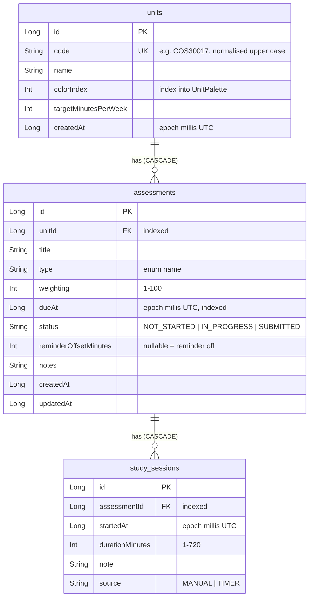
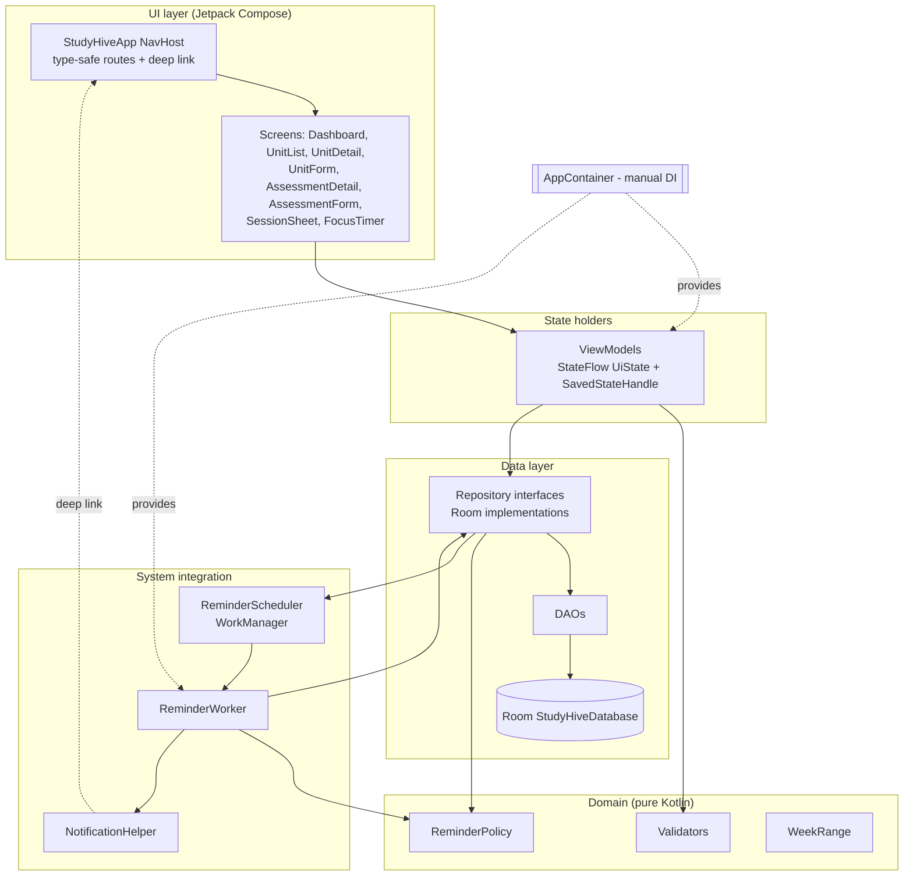
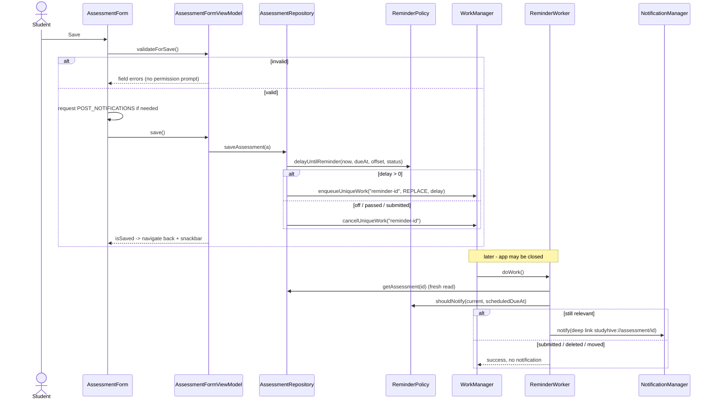
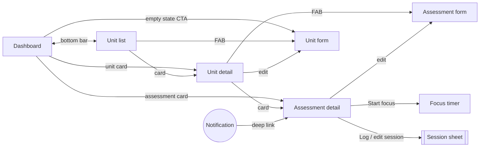
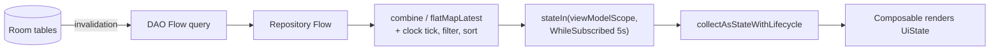

# StudyHive - Design and technical decisions

This document follows the design chain required by the brief - Vision -> User stories -> Use cases
-> Prototype -> Data model -> Architecture - and then records the decisions the report has to
justify: state ownership, asynchronous work, notifications, side effects, UX and testing.
Architecture diagrams are in the [Appendix](#appendix-architecture-diagrams).

---

## 1. Vision

**Problem.** Students take 3-4 units a semester, each with several assessments of different
weight and due date. Deadlines live in Canvas, email and memory; students notice an assessment too
late and cannot see how their study time is split across units.

**Users.** Undergraduate students (initially Swinburne students) who use an Android phone as their
main planning device.

**Vision.** One offline-first app in which a student records units and assessments, logs study
time, sees what is due next, and is reminded before deadlines - even when the app is closed.

**Scope.** Single user, local data only, about one semester of data (the investigation tests far
beyond that). Out of scope: accounts, cloud sync, Canvas import, recurring assessments, widgets.

## 2. Requirements

| ID | Functional requirement | Where |
|---|---|---|
| FR1 | Create, view, edit, delete units (code, name, colour, weekly target hours) | Unit list / detail / form |
| FR2 | Create, view, edit, delete assessments (title, type, weighting, due date/time, status, reminder, notes) | Unit detail, assessment detail / form |
| FR3 | Log, edit, delete study sessions manually or from a focus timer | Assessment detail, session sheet, focus timer |
| FR4 | Dashboard: overdue, due in 7 days, later count, per-unit weekly progress | Dashboard |
| FR5 | Filter a unit's assessments by status and sort by due date or weighting | Unit detail |
| FR6 | Reminder a chosen time before each deadline; rescheduled on edit, cancelled on submit/delete | Repository + WorkManager |
| FR7 | Ask for notification permission (Android 13+) in context; keep working if refused | Assessment form, detail banner |
| FR8 | Validation: required fields, unit code format and uniqueness, weighting 1-100 and unit total <= 100, duration 1-720 min, no future sessions | Pure validators |
| FR9 | Confirm every delete; state cascade consequences with real counts | Dialogs |
| FR10 | Focus timer that survives rotation/process death and saves a session on stop | Focus timer |

| ID | Non-functional requirement | How it is met |
|---|---|---|
| NFR1 | Data survives restarts and process death | Room; form drafts and timer in `SavedStateHandle` |
| NFR2 | No database work on the main thread | Room `suspend`/`Flow` APIs run on Room's executors |
| NFR3 | UI updates automatically when data changes | Room `Flow` -> `stateIn` -> `collectAsStateWithLifecycle` |
| NFR4 | Loading, empty and error states on every data screen | Sealed `UiState` per screen |
| NFR5 | Accessibility: labels, 48dp targets, contrast, large fonts, dark theme | `AccessibilityTest`, `ThemeContrastTest` |
| NFR6 | Fully offline, no network permission | Manifest has only `POST_NOTIFICATIONS` |
| NFR7 | Testable: repositories replaceable by fakes, DB tests on in-memory Room | Repository interfaces, `AppContainer` |
| NFR8 | minSdk 26, targetSdk 37 | minSdk raised from A2's 24 to use `java.time` without desugaring |

## 3. User stories

| # | As a student, I want to... | so that... | Acceptance (verified by) |
|---|---|---|---|
| US1 | add my units for the semester | assessments are organised by subject | Unit appears on dashboard immediately (`StudyHiveAppTest.createUnit_...`) |
| US2 | record each assessment's due date and weighting | I can prioritise high-stakes work | Weighting over the unit's remaining % is rejected (`AssessmentFormViewModelTest.weightingCap_...`) |
| US3 | get a reminder before a deadline | I don't miss it even if I haven't opened the app | A due reminder posts a notification (`ReminderNotificationTest.dueReminder_...`) |
| US4 | mark an assessment submitted | it stops looking urgent and its reminder is cancelled | `RepositoryIntegrationTest.submitting_cancelsReminder_...` |
| US5 | time a focus session | my study time is recorded without manual entry | `FocusTimerViewModelTest` |
| US6 | see time studied per unit this week | I can tell when I'm neglecting a unit | `StudyHiveDaoTest.progressQuery_...`, `WeekRangeTest` |
| US7 | fix or delete mistakes | my data stays accurate | Edit/delete flows; Undo for sessions (`StudyHiveAppTest.assessmentDetail_statusSessionAndUndo`) |

## 4. Use cases

**UC1 - Add an assessment with a reminder.** Precondition: a unit exists.
1. Student opens the unit and taps *Add assessment*.
2. Enters title, type, weighting, due date/time, reminder offset; taps *Save*.
3. The form is validated; only if it is valid, and a reminder is set, and permission is missing,
   Android's permission dialog is shown.
4. The assessment is saved; the repository schedules the reminder (or cancels it if the trigger
   time has passed or reminders are off).
5. Student returns to the unit with an "Assessment added" snackbar.

*Alternatives:* invalid field -> inline error, focusable by TalkBack, save blocked; weighting would
exceed 100% -> field error naming the remaining %; permission refused -> assessment still saved and
the detail screen shows a "notifications are off" banner with a *Settings* shortcut.

**UC2 - Complete an assessment.** On the detail screen the student taps *Submitted*. Room updates
the status, the repository cancels the pending reminder, and the dashboard/unit screens update
through their Flows without any manual refresh.

**UC3 - Delete a unit.** The student taps delete; a dialog states exactly how many assessments and
sessions will also be deleted and that reminders are cancelled. On confirm, Room's `CASCADE`
removes the children, every child reminder is cancelled, and the student returns with a snackbar.

*Design change from Phase 1:* the original plan offered Undo after deleting a unit. It was replaced
by an explicit confirmation with real counts, because restoring a cascade means re-inserting three
tables and re-scheduling reminders, which adds risk for a rare action. Undo was kept where it is
cheap and frequent - deleting a study session (re-insert one row with its original id).

## 5. Prototype and navigation

Low-fidelity sketches: *to be supplied by the student (scanned/drawn before implementation).*

The final screens are in `docs/evidence/screenshots/` (captured from the running app over seeded
demo data by `ScreenshotCapture`). The navigation graph is in Appendix A3.

| Screen | Purpose | Notable UI decisions |
|---|---|---|
| Dashboard (start) | What needs attention now | Summary card, horizontal unit row (`LazyRow`), sectioned `LazyColumn`: Overdue / Next 7 days / Later count |
| Unit list | All units with weekly progress | `LazyColumn` of progress cards; FAB to add |
| Unit detail | One unit's assessments | Weighting allocated bar, status filter chips, sort toggle, cascade-delete dialog |
| Assessment detail | Act on one assessment | Segmented status buttons, reminder card (or blocked banner), sessions list with Undo |
| Unit / Assessment form | Create and edit | Full-screen, inline validation after first save, discard guard |
| Session sheet | Log or edit a session | Bottom sheet: short task, keeps the assessment visible behind |
| Focus timer | Timed study | Screen kept on while running, survives rotation and process death |

## 6. Data model

**Why this model.**
- *Three entities, two one-to-many relations* mirror how students think (unit -> assessment ->
  time spent) and give meaningful CRUD at every level, plus real relational behaviour: foreign
  keys, cascades, joins and aggregates.
- *Derived values are never stored.* Weekly minutes, submitted counts and weighting totals are
  computed by queries, so they cannot drift out of sync with the rows they summarise.
- *Foreign keys with `CASCADE`* make "delete unit" consistent in one statement; the repository
  reads the child ids first so it can cancel their reminders.
- *Indices* on every foreign key (avoids full scans on joins and cascades) and on `dueAt` (the
  outstanding list is ordered by it). A unique index on `units.code` enforces uniqueness in the
  database; the repository translates the constraint error into `DuplicateUnitCodeException`, which
  the form shows as a field error.
- *Times are UTC epoch millis*; time zones are applied only when displaying or computing the week
  (`WeekRange`), which is correct across DST (tested with a 169-hour week).
- *`reminderOffsetMinutes` is nullable* so "off" is explicit rather than a magic number.
- *`colorIndex`, not a colour value,* so the palette can be retuned without a migration.
- *Enums stored by name* (Room's default) keep the database readable and stable under reordering.
- *Rules spanning rows* (unit weighting total <= 100%) are enforced in the ViewModel at save time,
  re-reading the total so a stale value cannot be used.
- The schema is exported (`app/schemas/.../1.json`) so future versions can be migrated and tested.

## 7. Architecture

Compose UI -> ViewModel -> Repository -> DAO -> Room, plus a small pure-Kotlin `domain` package
(see Appendix A1 for the diagram).

| Layer | Responsibility | Not responsible for |
|---|---|---|
| Compose screens | Render a `UiState`, forward events, run UI-only side effects (snackbar, navigation, permission request, keep-screen-on) | Business rules, data access |
| ViewModels | Turn repository Flows into one screen `StateFlow`; validate; hold transient UI state; survive configuration change | Android framework APIs, SQL |
| Domain (`ReminderPolicy`, validators, `WeekRange`) | Pure rules, no Android dependencies | State, I/O |
| Repositories | The app's data API; keep invariants that span storage and the system (schedule/cancel reminders on every write; translate SQLite errors) | UI state |
| DAOs / Room | Queries, constraints, transactions, change notification | Business rules |
| `notifications` | WorkManager scheduling, worker, channel and notification building | Deciding *whether* to notify (asks `ReminderPolicy`) |

**Decisions.**
- *Reminder scheduling lives in the repository*, not the ViewModel: every code path that changes an
  assessment (form save, status change, delete, unit cascade) goes through it, so a reminder can
  never be left pointing at stale data. The scheduler sits behind an interface, so tests use a
  recording fake and only `ReminderNotificationTest` uses the real WorkManager.
- *Manual DI (`AppContainer`) instead of Hilt*: three repositories and one scheduler do not justify
  annotation processing and generated components; the container is also trivial to replace in
  instrumented tests (`StudyHiveApplication.container = TestAppContainer(...)`).
- *Type-safe navigation* with `@Serializable` routes; ViewModels receive ids via
  `SavedStateHandle.toRoute()` in `AppViewModelProvider`, so they never parse strings.
- *Stateless `...Content` composables* separated from the VM-wired `...Screen` make every visual
  state testable without a database (`ScreenContentTest`).

## 8. State ownership

| State | Owner | Why there |
|---|---|---|
| Units, assessments, sessions | Room | Must survive process death; single source of truth |
| Screen data (combined, filtered, sorted) | ViewModel `StateFlow` via `stateIn` | Derived from Room; survives rotation; recomputed, not stored |
| Form drafts, unit-detail filter/sort, running timer timestamps | `SavedStateHandle` (`SavedDraft`, JSON) | Survives process death, so a half-typed form or running timer is not lost |
| "Saving", errors, one-off messages | ViewModel | Transient but must survive rotation |
| Dialog open/closed, date picker open | `rememberSaveable` in the composable | Pure UI, survives rotation, irrelevant to logic |
| Notification permission status | Read from the system on `ON_RESUME` | The user can change it in Settings at any time |

Read screens use a **sealed** `UiState` (`Loading / Content / NotFound / Deleted / Error`) because
the states are mutually exclusive; forms use a **data class** because fields, errors and flags
coexist. `SharingStarted.WhileSubscribed(5_000)` keeps upstream Room queries alive across a
rotation (< 5 s) but stops them when the user leaves; forms use `Eagerly` because their state must
exist before the first collector to restore drafts.

## 9. Coroutines and asynchronous work

| Work | Layer | Scope / mechanism | Why this scope |
|---|---|---|---|
| Observing Room (`Flow`) | DAO -> ViewModel | `stateIn(viewModelScope, WhileSubscribed(5000))` | Tied to the screen's lifetime, survives rotation, cancelled when the VM is cleared |
| Writes (save, delete, status) | ViewModel -> repository (`suspend`) | `viewModelScope.launch` | Must finish even if the composable leaves (e.g. navigating back after Save) but not outlive the screen's owner; Room moves the I/O off the main thread |
| Dashboard time tick | ViewModel | `flow { while(true) { emit; delay(60s) } }` inside `flatMapLatest` | "Overdue" and "this week" change with time, not just data; cancelled with the subscription |
| Retry after error | ViewModel | `MutableStateFlow` trigger + `flatMapLatest` | Restarts the whole upstream cleanly |
| Reminder at a future time | WorkManager | `CoroutineWorker.doWork()` | Must run when the app is closed or after reboot; a coroutine scope cannot do that |
| Snackbar + Undo | Composable | `rememberCoroutineScope()` | Started by a click, and `showSnackbar` suspends until dismissed |
| Snackbar after popping a screen | App root | `rememberCoroutineScope()` in `StudyHiveApp` | The popped screen's scope is cancelled by navigation; the root outlives it |
| Focus-timer display tick | Composable | `LaunchedEffect(isRunning)` | Display only - elapsed time is computed from stored timestamps, so cancellation never loses time |

`CancellationException` is always re-thrown before generic `catch (Exception)`, so cancellation is
never reported to the user as an error. Tests use `kotlinx-coroutines-test` with a Main-dispatcher
rule; the in-memory Room tests use real dispatchers.

## 10. Notifications

Deadline reminders are the one place the app must act while closed. Flow (Appendix A2):
save -> repository -> `ReminderPolicy.delayUntilReminder` -> unique WorkManager work
`reminder-<id>` with `REPLACE` -> at trigger time `ReminderWorker` **re-reads** the assessment and
asks `ReminderPolicy.shouldNotify` (suppressed if submitted, deleted, reminder turned off, or the
deadline moved) -> notification on a high-importance channel -> tap deep-links to
`studyhive://assessment/<id>` (explicit intent, so no exported intent filter).

- *WorkManager, not `AlarmManager`:* minutes of delay are acceptable for a reminder set hours or
  days ahead; exact alarms need `SCHEDULE_EXACT_ALARM`, which Android reserves for alarm/calendar
  apps. WorkManager persists across reboots.
- *Permission in context:* requested only when saving a valid assessment that has a reminder;
  refusal never blocks saving, and the detail screen explains the consequence with a Settings link.

## 11. Compose side effects

| Effect | Where | Purpose |
|---|---|---|
| `LaunchedEffect(isSaved)` + `rememberUpdatedState(onSaved)` | Forms, focus timer | Navigate once after a successful save, with the latest callback |
| `LaunchedEffect(message?.id)` | All VM screens | Show a one-off message exactly once, then tell the VM it was consumed |
| `LaunchedEffect(deleted)` | Unit/assessment detail | Leave a screen whose data no longer exists |
| `LaunchedEffect(isRunning)` | Focus timer | Tick the display only while running |
| `DisposableEffect(view, isRunning)` | Focus timer | Keep the screen on while timing; always released on dispose |
| `DisposableEffect(lifecycleOwner)` | Assessment detail | Re-check notification permission on `ON_RESUME` (user may return from Settings) |
| `rememberLauncherForActivityResult(RequestPermission)` | Assessment form | Contextual runtime permission |
| `BackHandler` | Forms (dirty), focus timer (started) | Prevent accidental loss of typed data or timed minutes |
| `rememberCoroutineScope` | Detail screen, app root | Suspend work started by events (Undo snackbar, post-navigation message) |

## 12. User experience

- **Loading / empty / error** states on every data screen; empty states explain what to do and
  offer the action; errors offer *Try again* (dashboard).
- **Validation** appears after the first save attempt and then updates live; errors are exposed as
  accessibility errors, not just red text.
- **Destructive actions** always confirm and state consequences with real counts; cheap ones
  (session delete) offer Undo instead.
- **Accessibility** (tested): every clickable has a label and a >= 48dp target in light and dark
  theme; forms and empty states remain usable at 200% font size (they scroll instead of clipping);
  all text/background pairs meet WCAG AA 4.5:1; cards merge into one TalkBack item with a full
  description; headings are marked; the timer is a polite live region.
- **State preservation**: drafts, filters and the running timer survive rotation and process death.
- **Locale**: dates and times are formatted with the current locale and re-read on change.

## 13. Testing strategy

| Level | Suite (source set) | Tests | What it proves |
|---|---|---|---|
| Unit (pure) | `ValidationTest`, `ReminderPolicyTest`, `WeekRangeTest`, `KotlinAggregationTest`, `ThemeContrastTest` (`test`) | see report table | Rules incl. boundaries: weighting 0/1/100/101, total exactly 100, duration 0/1/720/721, reminder in the past, DST week, contrast >= 4.5 |
| ViewModel / state | `FormViewModelTest`, `ObservingViewModelTest` (`test`) | | State transitions with fake repositories: errors after first save, save-time weighting re-read, process-death restore, failure messages, timer maths |
| Database | `StudyHiveDaoTest` (`androidTest`, in-memory Room) | | Constraints (unique, FK), cascade, ordering, week filter, Flow re-emission |
| Integration | `RepositoryIntegrationTest`, `ReminderNotificationTest` | | Repository + Room + scheduler; real WorkManager (test driver) posts / suppresses the real notification |
| Compose UI | `ScreenContentTest` | | Each visual state of stateless content, semantics of errors, dialogs |
| End-to-end | `StudyHiveAppTest` | | Real NavHost + ViewModels + Room: create, validate, status change, session + Undo, delete with cascade |
| Accessibility | `AccessibilityTest` | | Labels and touch targets on every screen, light/dark, 200% font |

Exact counts and results are taken from the executed reports in `docs/evidence/tests/`.

**How testing changed the implementation** (all found by tests, then fixed):
1. ViewModels created before the Main-dispatcher rule stayed `Loading` -> ViewModel creation moved
   to `by lazy` in tests (a JVM-testing lesson, not an app bug).
2. *Add unit/assessment* FABs had **no accessible name**: Material's `ExtendedFloatingActionButton`
   hides its text from accessibility and takes the label from the icon -> icon now labelled.
3. Permission dialog appeared **before validation** -> validate first, ask only for a valid form.
4. The Undo snackbar **queued behind stale messages** -> new snackbars replace the current one.
5. Unit progress cards were **split into an unlabelled button + text** for TalkBack (nested
   `mergeDescendants`) -> merge removed.
6. Empty/error states and the focus timer **clipped at large font sizes** -> made scrollable.
7. Lint: locale read non-observably -> formatter built per call; dead template resources removed.
8. A flaky end-to-end test showed Room's executor is invisible to Compose's idling -> explicit waits.

## 14. If the app became substantially larger

- **Modules:** split into `:core:data`, `:core:domain`, `:feature:*` to enforce layer boundaries and
  speed up builds; move to **Hilt** once the dependency graph has many more nodes.
- **Data volume:** page session lists with Paging 3; add a `startedAt` (or composite) index, which
  the investigation identifies as the next bottleneck; keep aggregation in SQL.
- **Schema evolution:** Room auto/manual migrations with `MigrationTestHelper` tests (schemas are
  already exported).
- **Sync and accounts:** a remote data source behind the same repository interfaces, with Room as
  the offline cache and WorkManager for sync.
- **Localisation:** move UI strings to resources (currently English-only strings in code).
- **Undo for cascades:** soft-delete (`deletedAt`) with a purge worker, instead of re-inserting.
- **Reminders:** per-assessment multiple reminders and a dedicated channel per type.

## 15. Known limitations

- Investigation measured on an emulator in a debug build (see `INVESTIGATION.md`).
- No migration yet (version 1); no backup/export.
- UI strings are not localised; dates are.
- Reminder delivery can be delayed by Doze/WorkManager by design.

---

## Appendix: Architecture diagrams

### A1. Layers and components

### A2. Reminder lifecycle

### A3. Navigation graph

### A4. Read path for a screen

---

## Reflection on Assignment 2 (student to complete)

Facts from the A2 project (DeskHive) that can anchor the reflection:

- A2 kept bookings **in memory**, so data was lost when the process died; A3 uses Room as the
  single source of truth and `SavedStateHandle` for in-progress input.
- A2 exposed one immutable `BookingUiState` as `StateFlow` from a single ViewModel; A3 keeps that
  pattern but gives each screen its own ViewModel and a **sealed** state derived from Room Flows.
- A2's `UserMessage(id, text)` consumable message and pure validator classes with JVM tests were
  reused directly.
- A2 had no repository or DI; A3 adds repository interfaces and a manual `AppContainer`, which is
  what made fakes and in-memory database tests possible.

*Personal reflection (what you found hard in A2, what you changed and why): to be written by the
student.*
