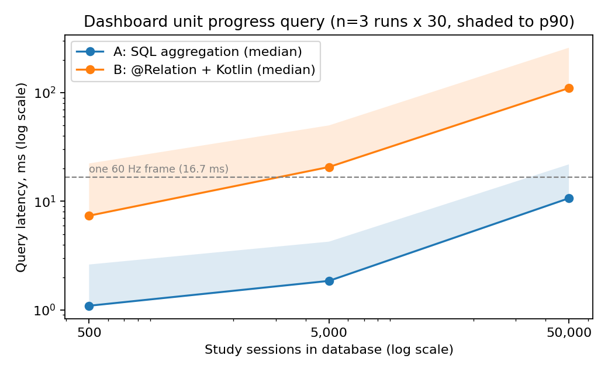

# Technical Investigation: Dashboard aggregation strategy

## Research question

For the StudyHive dashboard's *unit progress* row (per unit: number of assessments, number
submitted, minutes studied this week), is it better to

- **A. aggregate in SQL** - one Room query using correlated sub-queries / `GROUP BY`, returning
  one `UnitProgress` row per unit, or
- **B. aggregate in Kotlin** - load `StudyUnit -> Assessment -> StudySession` with nested Room
  `@Relation` and compute the same numbers with collection operations?

The answer decides which implementation the shipped `StudyUnitDao` exposes to `DashboardViewModel`.

## Why this question matters to the app

The dashboard is the start destination and re-queries every time any of the three tables changes,
because Room `Flow` invalidation is table-based. Study sessions are the only table that grows
without bound (a student logging 3 sessions a day for 4 years produces ~4,000 rows), so the
strategy must stay fast as that table grows.

## Hypothesis

- H1: At a realistic one-semester size (about 500 sessions) both approaches complete well under
  one 16 ms frame, so either is acceptable for users.
- H2: B's latency grows roughly linearly with the total number of sessions, because every session
  row crosses the SQLite cursor and becomes a Kotlin object even though most are outside the
  current week. A grows more slowly because SQLite does the filtering and only one row per unit
  leaves the database.
- H3: At 50,000 sessions A is at least 5x faster than B.

## Variables

| Type | Variable | Values |
|---|---|---|
| Independent | Aggregation strategy | A (SQL), B (`@Relation` + Kotlin) |
| Independent | Total study sessions | 500, 5,000, 50,000 |
| Controlled | Units / assessments | 8 units x 6 assessments = 48 assessments |
| Controlled | Session distribution | Uniform across assessments; `startedAt` uniform over 16 weeks, fixed RNG seed |
| Controlled | Device, build type, DB | Same emulator, debug build, fresh in-memory Room DB per dataset size |
| Dependent | Query latency | Wall-clock time of one complete read, `System.nanoTime()` |
| Dependent | Rows materialised | Number of entity objects created to answer the query (deterministic) |
| Dependent | Flow re-emission latency | Time from inserting one session to the dashboard `Flow` emitting the updated value |

## Method

1. An instrumented test (`DashboardAggregationBenchmark`, `androidTest`) builds an in-memory
   `StudyHiveDatabase` and seeds it in a single transaction for each dataset size.
2. **Correctness gate:** A and B must return identical `UnitProgress` lists before any timing is
   recorded; otherwise the test fails.
3. For each strategy: 5 warm-up runs (discarded, lets ART JIT-compile the code path), then 30
   measured runs. Strategy order alternates per run (A,B,B,A,...) to reduce ordering bias.
4. Report median, p90, min and max per strategy and size. The median is used for conclusions
   because emulator timing has outliers (GC pauses, host scheduling).
5. Flow re-emission: subscribe to each strategy's `Flow`, insert one session, measure the time
   until the new value arrives; 20 repetitions at 50,000 sessions.
6. Results are written as CSV to the app's external files directory and logged with tag
   `StudyHiveBench`, then pulled with `adb pull` into `docs/evidence/`.
7. The whole experiment is repeated in 3 separate test executions to check stability across runs.

## Test environment

- Host: Apple M1 MacBook, 8 GB RAM, macOS 15.7.4
- Device: Android Emulator `Pixel_8`, Android 14 (API 34) arm64-v8a, 2 GB RAM
- Build: debug variant, in-memory Room database

## Expected evidence

- CSV of every measured run, and a summary table (median / p90 per strategy and size)
- A chart of median latency against dataset size
- The rows-materialised count per strategy, which explains *why* the latency differs
- The test report showing the correctness gate passed

## Limitations (stated in advance)

- An emulator is not a phone: absolute times will differ on real hardware, so conclusions rely on
  the *relative* difference and the growth trend, not absolute milliseconds.
- A debug build disables some optimisations. Jetpack Microbenchmark (a separate module that locks
  clocks and works best on a physical device) would be more rigorous; it was not used to keep the
  project to one module, and because no physical device was available.
- An in-memory database removes disk I/O, which favours both strategies equally but under-states
  real cold-start latency.
- Synthetic data: uniform distribution may not match real study behaviour.

## Execution notes

- Executed on 1 Nov 2026 in the environment above. The test was run three times (`run1`-`run3`)
  with `adb shell am instrument ... -e benchLabel runN` rather than `connectedDebugAndroidTest`,
  because the Gradle task uninstalls the app afterwards and deletes the CSVs with it.
- The correctness gate passed at all three sizes in all three runs (the test reports `OK (1 test)`).
- Raw data: `docs/evidence/benchmark/raw_run{1,2,3}.csv` (one row per measured run, nanoseconds)
  and `materialised_run{1,2,3}.csv`. Summary and chart are regenerated by
  `python3 scripts/analyse_benchmark.py`.

## Results

Query latency, 3 runs x 30 measured repetitions pooled (n = 90 per cell); re-emission n = 60.

| Metric | Sessions | Strategy | Median (ms) | p90 (ms) | Min | Max | Run medians (1 / 2 / 3) | B/A median |
|---|---|---|---|---|---|---|---|---|
| query | 500 | A | 1.09 | 2.62 | 0.77 | 20.01 | 1.59 / 0.98 / 0.94 | |
| query | 500 | B | 7.37 | 22.32 | 5.63 | 47.71 | 15.89 / 6.69 / 6.21 | 6.7x |
| query | 5,000 | A | 1.85 | 4.25 | 1.54 | 11.73 | 2.90 / 1.72 / 1.75 | |
| query | 5,000 | B | 20.69 | 49.98 | 13.41 | 94.98 | 38.39 / 18.13 / 18.15 | 11.2x |
| query | 50,000 | A | 10.67 | 21.88 | 9.69 | 32.40 | 19.38 / 10.29 / 10.33 | |
| query | 50,000 | B | 110.15 | 259.29 | 103.08 | 456.16 | 222.30 / 108.35 / 106.43 | 10.3x |
| Flow re-emission | 50,000 | A | 11.60 | 35.47 | 11.08 | 61.43 | 27.23 / 11.36 / 11.55 | |
| Flow re-emission | 50,000 | B | 115.95 | 206.65 | 103.76 | 243.85 | 192.08 / 115.27 / 108.97 | 10.0x |

Objects materialised to answer one query (deterministic, identical in every run):

| Sessions | A | B |
|---|---|---|
| 500 | 8 | 556 |
| 5,000 | 8 | 5,056 |
| 50,000 | 8 | 50,056 |

**Run-to-run variation.** Run 1 was roughly twice as slow as runs 2 and 3 for *both* strategies
(e.g. A at 50,000: 19.38 ms vs 10.29 / 10.33 ms), while runs 2 and 3 agree within 8% in every cell. Run 1
was the first execution after a fresh install; the likely (not verified) cause is that the code was
still interpreted/JIT-compiled and the emulator had just been busy installing, which 5 warm-up runs
did not fully absorb. Because the slowdown affected both strategies, the B/A ratio per run stays
similar (at 50,000: 11.5x, 10.5x, 10.3x), so the conclusions below do not depend on run 1. The
pooled p90 and max values are inflated by run 1 and are less reliable than the medians.

## Interpretation

- **H1 - supported for the median, not for the tail.** At 500 sessions both strategies have a median
  below one 16.7 ms frame (A 1.09 ms, B 7.37 ms). B's pooled p90 (22.32 ms) exceeds it, and B's run 1
  median (15.89 ms) is close to it, so B is acceptable at semester size but has little headroom.
  Room runs these queries off the main thread, so the frame budget here means "the dashboard
  updates within the next frame", not jank on the UI thread.
- **H2 - partly supported.** B grows with the session count: 2.8x from 500 to 5,000, then 5.3x from
  5,000 to 50,000, approaching linear growth once fixed costs (the transaction and the unit and
  assessment queries) stop dominating. This matches the materialised-object count, which is linear
  for B (556 -> 50,056) and constant for A (8). A was *not* flat, though: it grew 5.8x from 5,000 to
  50,000, because SQLite still has to scan sessions to sum this week's minutes (sessions are indexed
  by `assessmentId`, not by `startedAt`). A grows more slowly overall (9.8x vs 15x from 500 to
  50,000), but the claim that A "only pays for one row per unit" was too strong.
- **H3 - supported.** At 50,000 sessions A is 10.3x faster than B (median 10.67 vs 110.15 ms), above
  the 5x threshold, and the ratio is consistent across runs and in the Flow re-emission measurement
  (10.0x), which is the latency a user actually sees after logging a session.

## Recommendation

Ship **strategy A** (`StudyUnitDao.observeProgress`, SQL aggregation) for the dashboard, which is
what `DashboardViewModel` and `UnitListViewModel` use. It was faster at every size tested (6.7x-11.2x by median), creates a
constant 8 objects instead of one object per session, and keeps the dashboard update under one frame
up to 50,000 sessions by median. Strategy B remains in the DAO only as the investigation baseline and
for the `KotlinAggregationTest` unit tests; its readable Kotlin aggregation is fine for small,
bounded data but not for an unbounded, growing table.

Follow-up worth testing: an index on `study_sessions.startedAt` (or a composite
`(assessmentId, startedAt)`) could reduce A's growth further, since the weekly filter currently
scans each assessment's sessions. It was not tested here, so no claim is made about its effect.
